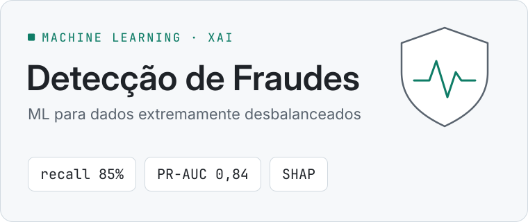
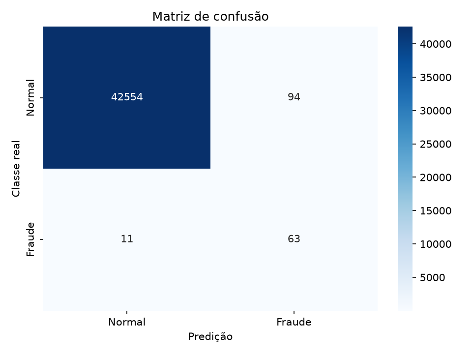
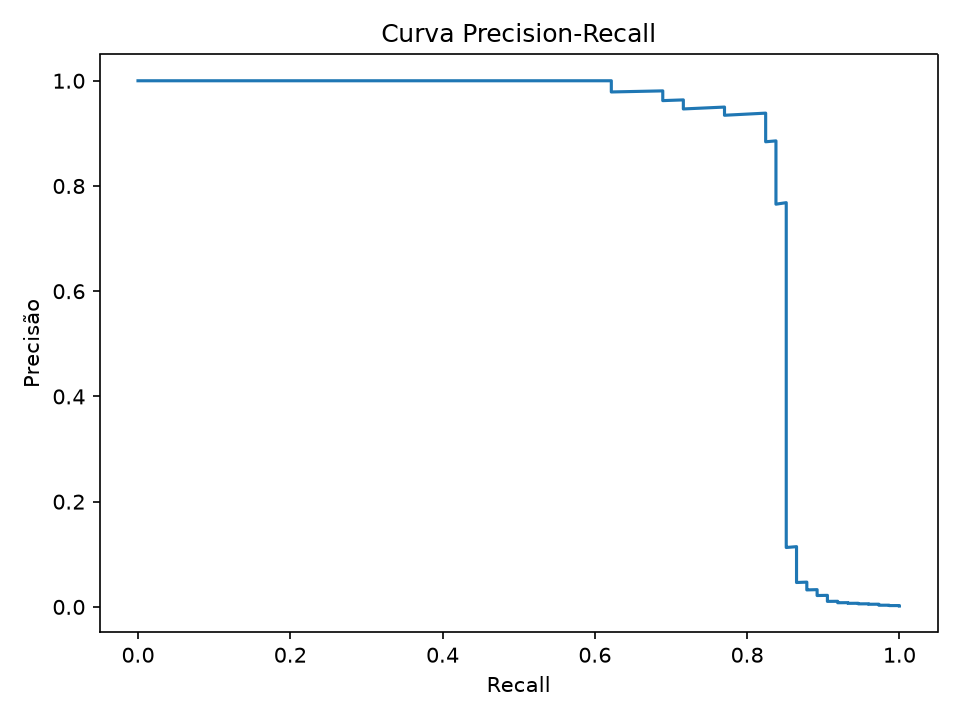
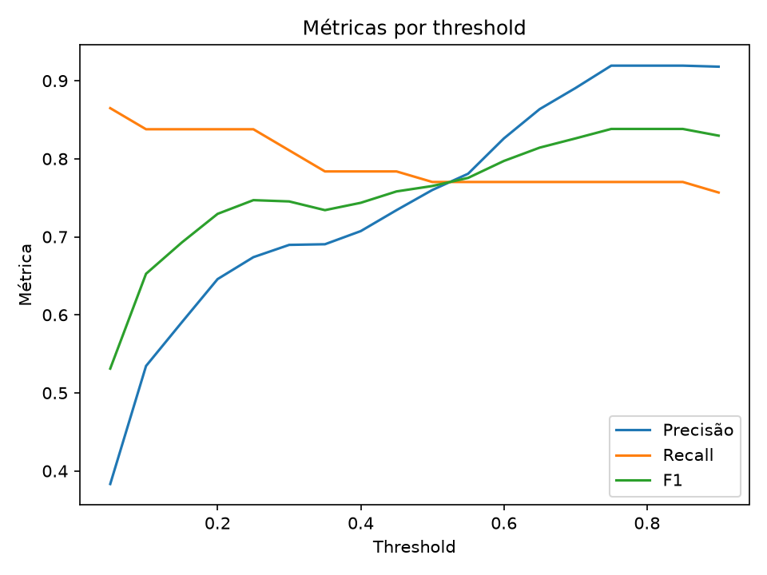

<picture>
  <source media="(prefers-color-scheme: dark)" srcset="assets/cover-dark.svg">
  
</picture>

<p align="center"><strong>Machine Learning de ponta a ponta para detectar fraudes em dados extremamente desbalanceados.</strong></p>

<p align="center">
  
  
  
  
  
  
  
</p>

## Em 30 segundos

- **Problema:** detectar transações fraudulentas num dataset em que a fraude é rara (*Credit Card Fraud Detection*). Nesse cenário a acurácia engana: um modelo que nunca acusa fraude já parece excelente.
- **Solução:** pipeline `imblearn` sem *data leakage*, comparação entre regressão logística, Random Forest e XGBoost com diferentes estratégias de balanceamento, threshold escolhido na validação por custo de negócio e explicabilidade com SHAP.
- **Resultado no teste isolado:** o XGBoost com pesos detectou 63 de 74 fraudes (recall de 85,1%), com PR-AUC de 0,84 e ROC-AUC de 0,97. Detalhes no [relatório executivo](https://yancarneosso.github.io/fraud-detection-ml/).
- **Stack:** Python · pandas · scikit-learn · imbalanced-learn · XGBoost · SHAP · pytest · GitHub Actions
- **Por onde começar:** [metodologia](docs/METHODOLOGY.md) · [decisões técnicas](docs/DECISIONS.md) · [arquitetura](docs/ARCHITECTURE.md)

## Sobre o projeto

Projeto de portfólio em Machine Learning aplicado à identificação de transações
fraudulentas. A solução cobre o ciclo completo: validação dos dados, análise exploratória,
engenharia de atributos, prevenção de leakage, experimentação, otimização, explicabilidade,
persistência, inferência, testes e apresentação executiva.

[Ver relatório executivo](https://yancarneosso.github.io/fraud-detection-ml/) ·
[Arquitetura](docs/ARCHITECTURE.md) ·
[Metodologia](docs/METHODOLOGY.md) ·
[Decisões técnicas](docs/DECISIONS.md)

## Competências demonstradas

- **Machine Learning:** classificação desbalanceada, seleção de modelos e tuning;
- **Engenharia de ML:** pipelines reproduzíveis, persistência e interface de inferência;
- **Estatística aplicada:** PR-AUC, ROC-AUC, threshold e custo de negócio;
- **Qualidade:** type hints, testes, logging, validações e integração contínua;
- **Explainable AI:** explicações SHAP globais e locais;
- **Comunicação:** relatório executivo autocontido e documentação para públicos técnicos
  e não técnicos.

> O dataset é extremamente desbalanceado. Por isso, acurácia isolada não é critério
> adequado e nenhum resultado é declarado sem execução.

## Demonstração visual

O relatório executivo transforma métricas técnicas em uma leitura orientada a negócio.
A versão completa está disponível em [yancarneosso.github.io/fraud-detection-ml](https://yancarneosso.github.io/fraud-detection-ml/) (código-fonte em [docs/index.html](docs/index.html)).

| Matriz de confusão | Curva Precision-Recall |
|---|---|
|  |  |

### Sensibilidade ao threshold



## Objetivo e abordagem

O fluxo valida e descreve os dados, gera EDA, cria features, divide os exemplos em
70% treino, 15% validação e 15% teste, compara modelos e estratégias de balanceamento,
escolhe o threshold na validação e consulta o teste uma única vez. O baseline
`DummyClassifier` evidencia como prever sempre a maioria pode produzir alta acurácia e
ser inútil para fraudes.

São avaliadas regressão logística (original, `class_weight`, undersampling e SMOTE),
Random Forest balanceada e XGBoost com `scale_pos_weight`. A busca opcional usa
`RandomizedSearchCV` e `StratifiedKFold(5)` com recall, F1, Average Precision ou custo
de negócio customizado (o scorer maximiza o custo negativo).

## Estrutura

```text
fraud-detection-ml/
├── .github/workflows/           # CI e publicação do relatório
├── data/{raw,processed}/
├── docs/                        # Documentação técnica e GitHub Pages
├── models/
├── notebooks/fraud_detection_analysis.ipynb
├── reports/{figures,metrics}/
├── src/
│   ├── config.py
│   ├── data_processing.py
│   ├── evaluate.py
│   ├── explain.py
│   ├── feature_engineering.py
│   ├── inference.py
│   ├── train.py
│   └── utils.py
├── tests/
├── main.py
└── requirements.txt
```

O diagrama detalhado do fluxo está em [docs/ARCHITECTURE.md](docs/ARCHITECTURE.md).

## Instalação

Requer Python 3.10 ou superior.

```bash
python -m venv .venv
```

Linux/macOS:

```bash
source .venv/bin/activate
```

Windows:

```powershell
.venv\Scripts\activate
```

```bash
pip install -r requirements.txt
```

Obtenha o arquivo `creditcard.csv` do dataset **Credit Card Fraud Detection** e coloque-o
em `data/raw/creditcard.csv`. O CSV não é versionado. Se estiver ausente ou com esquema
incompatível, o programa encerra com uma mensagem de correção, sem inventar dados.

## Execução

```bash
python main.py
python main.py --data data/raw/creditcard.csv --model xgboost
python main.py --model random_forest --search --scoring average_precision --explain
python main.py --threshold 0.30
pytest
```

`--threshold 0.30` serve para uma análise explícita; sem essa opção, o threshold é
selecionado na validação. O fluxo avalia de 0,05 a 0,90 e sempre inclui 0,30.

## Decisões técnicas

### Features

`Amount_log = log1p(Amount)` reduz a assimetria dos valores. `Time` é transformado em
hora e codificado por seno e cosseno para preservar sua natureza cíclica. `Amount`,
`Time` e a hora linear são removidos após a transformação para evitar redundância,
reduzir sensibilidade de escala e não sugerir uma falsa distância entre 23h e 0h. As
componentes PCA `V1`–`V28` são preservadas.

### Prevenção de data leakage

A divisão estratificada acontece antes de qualquer ajuste. Feature engineering,
`StandardScaler`, SMOTE/undersampling e modelo ficam em um `imblearn.Pipeline`; assim,
em validação cruzada cada operação aprende apenas com o fold de treino. Aplicar SMOTE
antes da divisão seria incorreto: exemplos sintéticos derivados de uma observação
poderiam aparecer nos dois lados e inflar as métricas. O threshold usa apenas validação;
hiperparâmetros usam apenas treino; o teste fica isolado até a decisão final.

### Métricas e custo

São calculados relatório de classificação, matriz de confusão, precisão, recall e F1 da
fraude, ROC-AUC, Average Precision/PR-AUC, falsos positivos e falsos negativos. ROC-AUC
e curvas recebem probabilidades, nunca classes binárias. Em forte desbalanceamento, a
curva Precision-Recall costuma revelar melhor o compromisso operacional, enquanto ROC
pode parecer otimista devido ao grande número de negativos.

O custo hipotético padrão é:

```text
custo = falsos_negativos × 1000 + falsos_positivos × 10
```

Esses números são configuráveis e não representam necessariamente custos bancários
reais. Um falso negativo é fraude não detectada; um falso positivo é uma operação
legítima bloqueada ou enviada à análise.

### Balanceamento e escolha

Undersampling reduz tempo e pode elevar recall, mas descarta informação da classe
majoritária. SMOTE preserva observações, porém pode sintetizar ruído e aumentar falsos
positivos. `class_weight` altera a penalidade sem gerar amostras. A tabela compara o
impacto real sobre precisão, recall e falsos positivos. O vencedor minimiza custo na
validação, com PR-AUC e recall como desempate; interpretabilidade, tempo e overfitting
devem ser revisados antes de produção. Não se escolhe automaticamente a maior ROC-AUC.

### Explicabilidade

`--explain` gera importância global, summary/bar plots e casos locais (fraude detectada,
falso positivo e falso negativo, quando existirem) em `reports/figures/shap/`. SHAP
quantifica contribuições das variáveis à previsão do modelo; não estabelece causalidade.

## Resultados e artefatos

Resultados reais surgem apenas depois da execução com o dataset:

- `reports/metrics/model_comparison.csv`: validação por modelo/estratégia;
- `reports/metrics/threshold_analysis.csv`: compromisso por threshold;
- `reports/metrics/final_test_metrics.json`: avaliação final isolada;
- `reports/fraud_detection_report.html`: relatório visual autocontido;
- `models/best_fraud_detection_pipeline.joblib`: pipeline completo;
- `models/model_metadata.json`: threshold, ordem das features, classe e métricas;
- `reports/figures/`: EDA, curvas e SHAP.

Os números do resumo no topo vêm da execução registrada no
[relatório executivo](https://yancarneosso.github.io/fraud-detection-ml/) (modelo `xgboost_weighted`, threshold 0,05,
42.648 transações legítimas e 74 fraudes no teste). Uma nova execução com o dataset
regenera todos os artefatos.

## Inferência

```python
from src.inference import predict_transaction

resultado = predict_transaction(
    transaction={  # informe Time, V1...V28 e Amount, todos numéricos
        "Time": 0.0,
        **{f"V{i}": 0.0 for i in range(1, 29)},
        "Amount": 10.0,
    },
    model_path="models/best_fraud_detection_pipeline.joblib",
    metadata_path="models/model_metadata.json",
)
```

O retorno possui `probabilidade_fraude`, `threshold` e `classificacao`. Features ausentes,
desconhecidas, não numéricas ou não finitas são rejeitadas.

## Limitações e melhorias

O dataset é anonimizado, antigo e não representa mudança de comportamento em produção.
O custo é simplificado; SMOTE em componentes PCA pode não representar transações reais;
e a divisão aleatória não simula integralmente drift temporal. Próximos passos: validação
temporal, calibração de probabilidades, custo por valor da transação, monitoramento de
drift, fairness, testes de carga e serviço de inferência versionado.

> Aviso: projeto exclusivamente educacional. Não deve bloquear transações reais sem
> validação de domínio, segurança, governança e monitoramento.

<p align="center">
  
</p>
