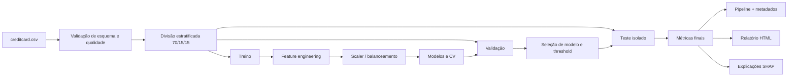

# Arquitetura

## Componentes

- `data_processing.py`: entrada, validação, divisão e EDA;
- `feature_engineering.py`: transformações determinísticas reutilizáveis;
- `train.py`: candidatos, balanceamento, CV, comparação e persistência;
- `evaluate.py`: métricas, custo, thresholds e gráficos;
- `explain.py`: explicabilidade global e local;
- `inference.py`: contrato de predição para novas transações;
- `report.py`: relatório executivo baseado nos artefatos reais;
- `main.py`: orquestração do fluxo.

O teste é acessado somente depois da seleção do modelo e do threshold.

